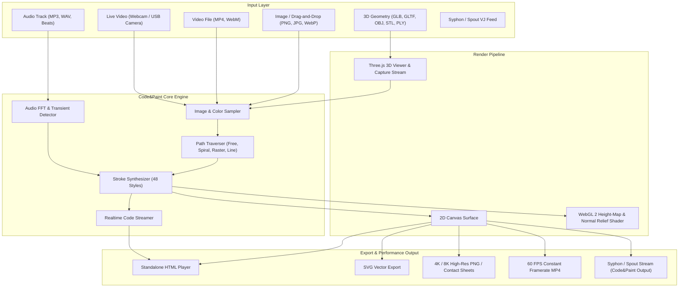
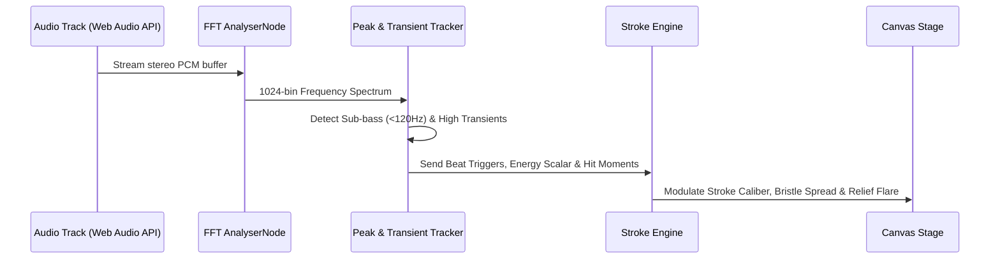

# Code&Paint System Architecture

> Version 5.0.0 · Comprehensive Technical Blueprint

---

## 1. High-Level System Architecture

---

## 2. Component Subsystems

### 2.1 Stroke Synthesizer & Brush Simulation
The core algorithm breaks down source frames into distinct organic marks. Each mark has:
1. **Geometric Topology**: Quadratic Bézier ribbons, elliptical stamps, or polyline splines.
2. **Pressure Profile**: Tapering endpoints, dry bristle dissipation, or continuous flow.
3. **Height Elevation Map**: Stamped into a 2D canvas elevation buffer representing physical relief (impasto oil ridges, clay edges, linocut cuts).
4. **Lighting Shader**: Computed in WebGL 2 with directional light sources and specular reflection.

### 2.2 Audio Reactivity Subsystem

### 2.3 Realtime Code Generation Subsystem
Every physical stroke dispatched by the engine is serialized as a concise JavaScript call:
- `E(cx, cy, rx, ry, angle, color)` — Elliptical stamp
- `B(x0, y0, cx, cy, x1, y1, color)` — Bézier ribbon
- `S(x0, y0, cx, cy, x1, y1, width, color)` — Pressure-variable stroke
- `T(text, x, y, font, size, color)` — Typographic ligature

The code buffer maintains a syntax-highlighted editor view and can bundle the entire generated artwork into a standalone self-executing HTML file containing its own micro-runtime.

### 2.4 Offline Frame-by-Frame Video Recorder
For rock-solid 60 FPS video capture up to 4K resolution, Code&Paint decouples wall-clock time from rendering:
1. Engine halts real-time requestAnimationFrame loops.
2. Time increments by `1 / fps` per frame.
3. Audio buffer slices are extracted synchronously.
4. Canvas renders complete simulation steps into an `OffscreenCanvas`.
5. Video frames are streamed into a background Web Worker running a constant-bitrate H.264/AAC muxer.
