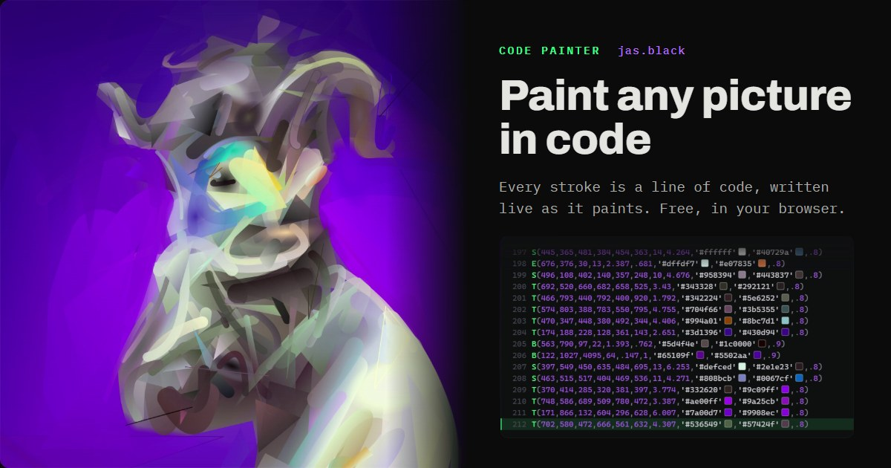
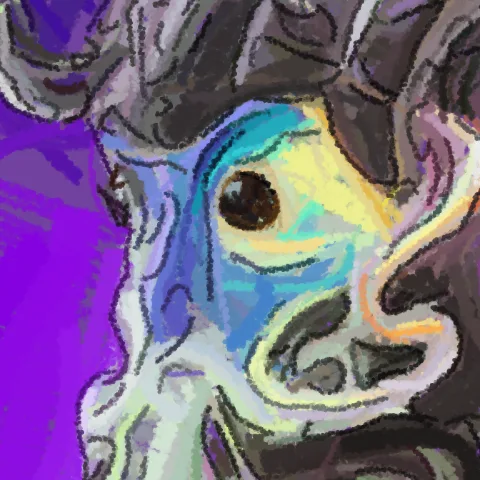
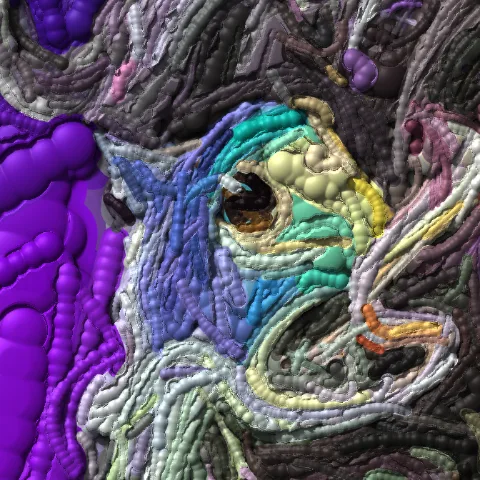
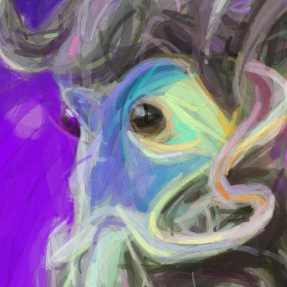
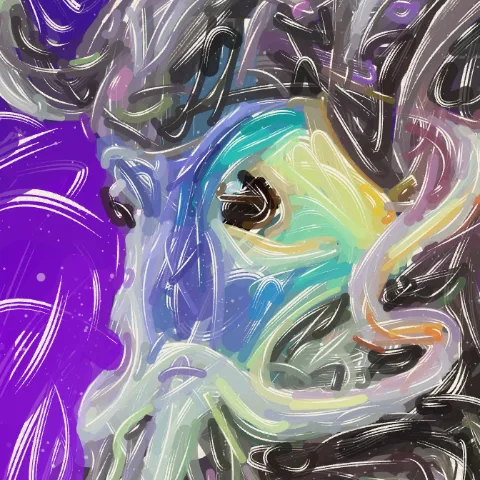
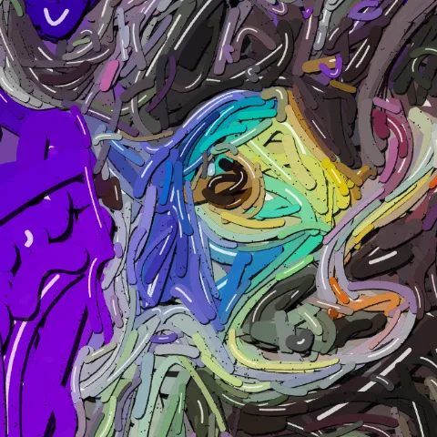
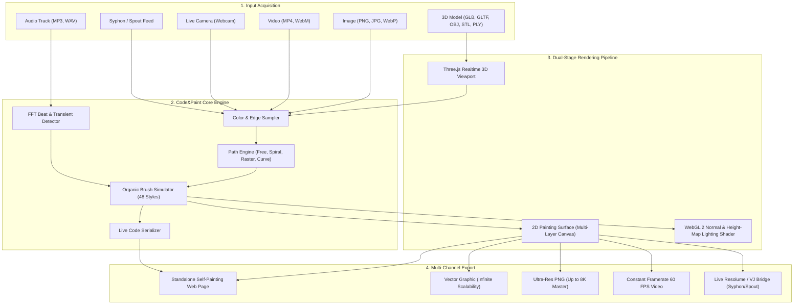
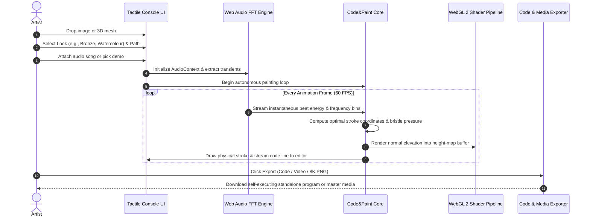

# 🎨 Code&Paint

<p align="center">
  
</p>

<p align="center">
  <strong>Visual Generative Coding & Algorithmic Painting Studio</strong><br />
  <em>Drop in any picture or 3D model and watch it painted in live code, stroke by stroke, with the program writing itself in real time.</em>
</p>

<p align="center">
  <a href="https://github.com/mahik504/Code-and-Paint/releases"></a>
  <a href="LICENSE"></a>
  <a href="https://github.com/mahik504/Code-and-Paint/stargazers"></a>
  
  
</p>

---

## 🌟 Overview

**Code&Paint** is an algorithmic art studio that bridges the gap between human painting and computational code. When you open any image, video, camera stream, or 3D model, the engine analyzes color distributions, gradients, and structural contours, translating them into hundreds of organic brushstrokes. 

As each stroke lands on the canvas, **the actual JavaScript code that generates it is typed out live beside it**. Add a music track, and the painting dances to the rhythm: heavy impasto drops on sub-bass kicks, fine line work etches on hi-hats, and 3D surface reliefs flare on musical peaks.

Everything runs **100% locally in the browser**. No cloud subscriptions, no external servers, no logins. Your media never leaves your computer.

---

## 🖼️ Example Styles

| Pencil & Graphite | Street Graffiti | Ceramic Foam |
| :---: | :---: | :---: |
|  |  |  |
| **Acrylic Impasto** | **Watercolour Wash** | **Linocut Print** |
|  |  |  |
| **Risograph Screen** | **Bronze Patina** | **Hylics Clay** |
|  |  |  |

---

## 🏛️ System Architecture



---

## ⚙️ Software Pipeline & Dataflow



---

## 🚀 Key Features

### 1. 48 Organic & Physical Styles
- **Paint**: Oil, acrylic, palette-knife, gouache, tempera, enamel, glaze, fresco. Each bristle carries independent pigment ridges and dry-out curves.
- **Draw**: Pencil, charcoal, dry pastel, fountain pen, fine liner, sumi ink, ballpoint, etching.
- **Graphic**: Linocut, risograph, halftone dots, woodblock, screen print, posterize, chalk.
- **Craft**: Felt, embroidery, tapestry, string art, beadwork, stained glass.
- **3D Lit Reliefs**: Real-time height maps lit in WebGL 2 — liquid chrome, brushed steel, antique bronze, raw gold, pewter, terracotta clay, ceramic tile, polished obsidian.

### 2. Deep Audio Reactivity
- **Transient Detection**: Automatic kick, snare, and percussion hit tracking.
- **Adaptive Dynamics**: Heavy strokes and saturated blooms on crescendo moments; delicate filigree marks during quiet passages.
- **Visual Score Generator**: Audio frequencies mapped along an organic central spine that pulses, blooms, and shoots sparks across the painting.

### 3. Integrated 3D Viewport
- Load your own `.glb`, `.gltf`, `.obj`, `.stl`, or `.ply` models.
- Orbit, zoom, and inspect models with studio-grade PBR iridescent lighting.
- The 3D viewport feeds directly into the painting sampler, repainting rotating geometry in real time.

### 4. Portable Standalone Artifacts
- **Save as Code**: Produces a tiny self-contained `.html` file that paints the entire picture from scratch when opened in any browser.
- **Reversible Workflows**: Dropping any PNG, SVG, or HTML file created with Code&Paint back onto the studio restores all original parameters, colors, and audio markers.

### 5. Live Resolume / VJ Bridge
- Full Syphon (macOS) and Spout (Windows) compatibility.
- Broadcast the live painting and live code stream as separate video sources to Resolume Arena, TouchDesigner, OBS, or MadMapper.

---

## 🛠️ Quick Start

### Option A: Direct Web Launch
Simply open `index.html` in Chrome, Edge, Brave, or Safari.

### Option B: Local Node.js Server
```bash
# Clone the repository
git clone https://github.com/mahik504/Code-and-Paint.git
cd Code-and-Paint

# Start the local development studio
npm start
# or: node serve.mjs
```
The studio will launch automatically at `http://localhost:8765`.

### Option C: Python 3 Server
```bash
python serve.py
```

### Option D: Double-Click Launcher
- **Windows**: Double-click `start.bat`.
- **macOS**: Double-click `start.command`.

---

## 📁 Repository Layout

```
Code&Paint/
├── index.html              # Complete studio console, shader runtime & engine
├── viewer3d.js             # Three.js 3D model viewport & capture pipeline
├── package.json            # Node.js project manifest & scripts
├── serve.mjs               # Zero-dependency Node.js local micro-server
├── serve.py                # Standalone Python 3 streaming server
├── start.bat               # Windows one-click desktop launcher
├── start.command           # macOS one-click desktop launcher
├── VERSION                 # Release tracking file (v5.0.0)
├── DESIGN.md               # Hardware tactile design system specification
├── ARCHITECTURE.md         # Comprehensive technical architecture document
├── docs/
│   ├── GUIDE.md            # Comprehensive user guide for all 48 styles
│   └── examples/           # High-resolution WebP demonstration renders
├── audio/demo/             # Royalty-free music stems for audio reactivity
├── vendor/                 # Localized third-party vendor assets
│   ├── three/              # Three.js core and loaders (MIT)
│   ├── fonts/              # Typography subsets (SIL OFL)
│   └── mediapipe/          # On-device face detail detector
└── download/
    └── code-and-paint-local.zip # Pre-packaged portable offline distribution
```

---

## 📄 License & Credits

- Licensed under the [MIT License](LICENSE).
- Created with passion by **Mahaveer Singh Gehlot** ([@mahik504](https://github.com/mahik504)).
- Brush mechanics build upon conceptual foundations from Alejandro Campos Uribe's *p5.brush*, Tyler Hobbs' watercolor layering techniques, David Li's paint height-map simulations, and three.js.
